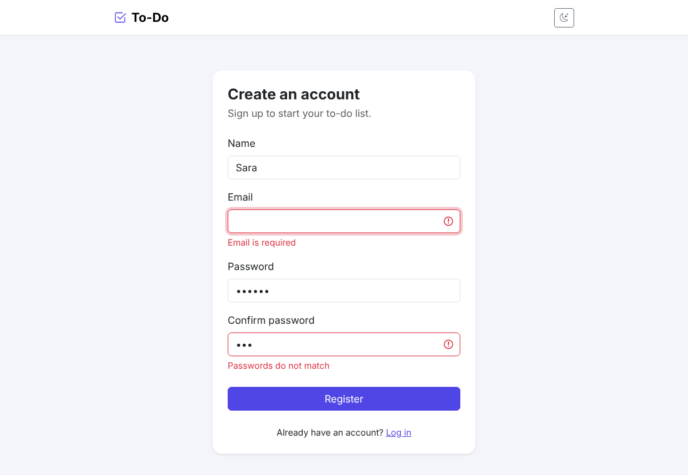
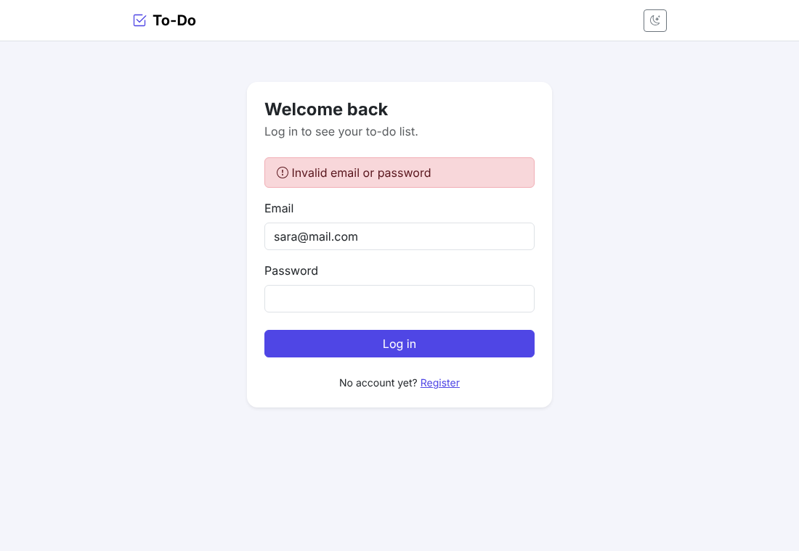
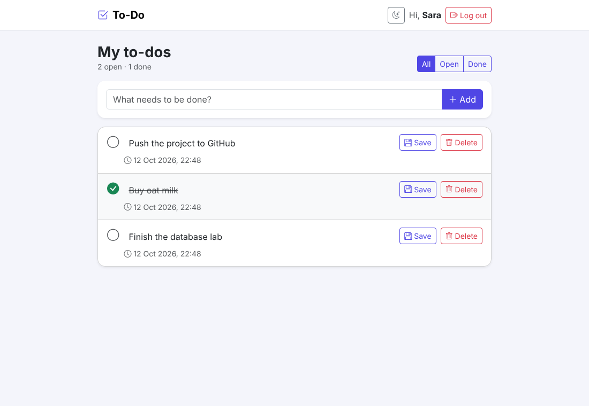
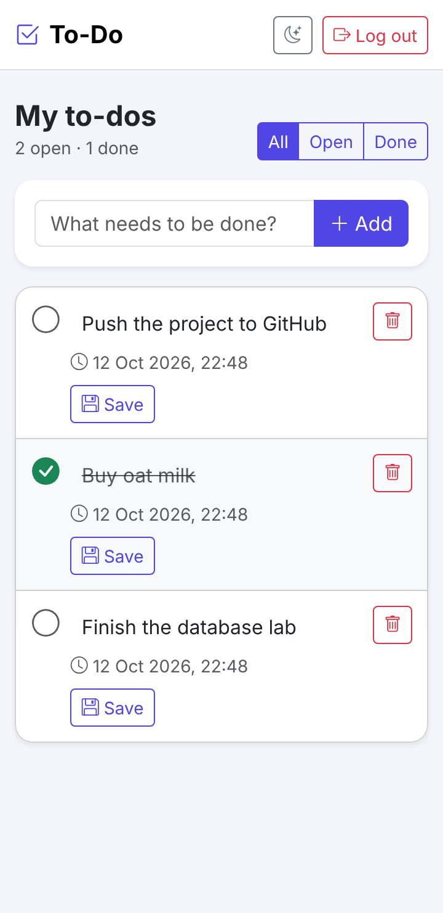
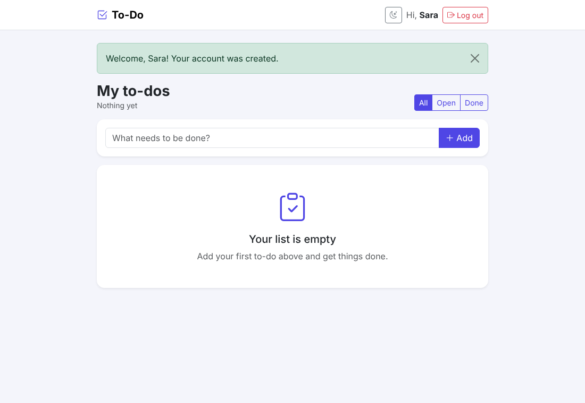
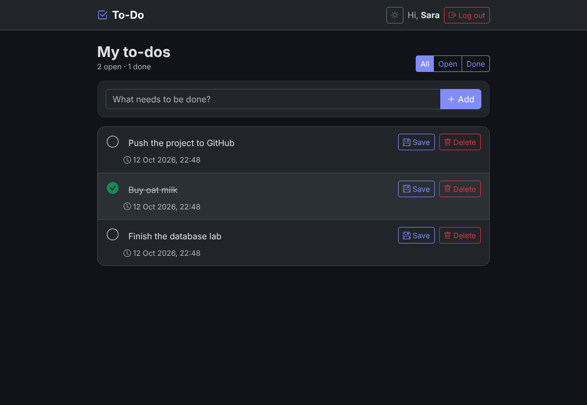

# Lab 2: Login & To-Do Application


A small web app where a user can sign up, log in, and manage a private to-do list.
Every value goes to MySQL as a parameter, passwords are stored as bcrypt hashes,
and every form is checked both in the browser and on the server.

## 1. Team

| Name | ID | Work |
|---|---|---|
| A'laa Sherif Ibrahim | 2304249 | Everything: database schema, Flask server, templates, validation, UI, README |
| Mariem Mohamed | 2304251 | Everything: database schema, Flask server, templates, validation, UI, README |

## 2. Technology

| Part | Used |
|---|---|
| Back end | Python 3 + Flask, PyMySQL (plain SQL, no ORM), bcrypt, python-dotenv |
| Front end | Jinja2 HTML templates, Bootstrap 5, Bootstrap Icons, plain JavaScript |
| Database | MySQL 8, database `registration` (tables `users` and `todos`) |

## 3. How to run it (from an empty machine)

**Install first:** Python 3.10+ (tick "Add Python to PATH" on Windows), MySQL Server 8 (+ MySQL Workbench), Git.

1. **Get the code**
   ```bash
   git clone <this-repo-url>
   cd db-lab2-alaa
   ```
2. **Build the database.** In MySQL Workbench open `database/schema.sql` and run it (lightning-bolt button), or from a terminal:
   ```bash
   mysql -u root -p < database/schema.sql
   ```
   The script starts with `DROP DATABASE IF EXISTS registration;`, so it can be run again at any time.
3. **Create a virtual environment and install the packages**
   ```bash
   python -m venv venv
   venv\Scripts\activate          # Windows
   source venv/bin/activate       # macOS / Linux
   pip install -r requirements.txt
   ```
4. **Configure secrets.** Copy `.env.example` to `.env` and put your real MySQL password and a random secret key in it:
   ```bash
   copy .env.example .env         # Windows
   cp .env.example .env           # macOS / Linux
   ```
5. **Start the server**
   ```bash
   python app.py
   ```
6. **Open** <http://127.0.0.1:5000> in a browser. You will be sent to the login page; click *Register* to create an account.

## 4. Features

| # | Requirement | How it is done |
|---|---|---|
| R1 | Register (name, email, password, confirm) | `POST /register` validates, hashes, `INSERT INTO users`. MySQL error 1062 (UNIQUE email) shows **Email Already Exists**. On success the user is logged in and redirected to the list. |
| R2 | Login / Logout | `SELECT user_id, name, password_hash FROM users WHERE email = %s`, then `bcrypt.checkpw`. A wrong email and a wrong password both show **Invalid email or password**. `/logout` clears the session. |
| R3 | Private list | A `login_required` decorator redirects visitors to `/login`. The list query filters by the session's `user_id`, newest first. |
| R4 | Add a to-do | `POST /add` → `INSERT INTO todos (user_id, title)` |
| R5 | Edit title | `POST /edit/<id>` → `UPDATE todos SET title = %s WHERE todo_id = %s AND user_id = %s` |
| R6 | Done / not done | `POST /toggle/<id>` → `UPDATE todos SET is_done = %s WHERE todo_id = %s AND user_id = %s` |
| R7 | Delete (with confirmation) | JavaScript `confirm()` first, then `POST /delete/<id>` → `DELETE FROM todos WHERE todo_id = %s AND user_id = %s` |
| R8 | Validation in browser and server | `static/app.js` checks the forms before sending; `app.py` checks the same rules again. Same exact messages in both. On a server error the page is shown again and the database is not touched. |
| R9 | Security | bcrypt hashes (`$2b$12$…`), only the given queries, always with `%s` parameters, `user_id` always from the session. |
| R10 | Good-looking UI | Bootstrap with one colour scheme and font on all pages, responsive down to 360 px, error messages under each field, done items crossed out, friendly empty state, name + Log out in the navbar, styled 404/500 pages (no stack traces). |

**Bonus**

- Filters: All / Open / Done
- Counter of open and done to-dos
- Dark mode toggle (remembered in the browser)

## 5. Screenshots

| Register with errors | Login |
|---|---|
|  |  |

| To-do list (one done) | Phone (360 px) |
|---|---|
|  |  |

| Empty list | Dark mode (bonus) |
|---|---|
|  |  |

## 6. Questions

**(a) Why do UPDATE and DELETE contain `AND user_id = ?`, and what changes if you remove it?**
The `todo_id` comes from the browser (it is in the URL), so anyone can send another person's to-do number. With `AND user_id = ?` (the id of the logged-in user, taken from the session) the statement changes zero rows when the to-do belongs to someone else. Without it, any logged-in user could edit, tick or delete any other user's to-dos just by changing the number in the request.

**(b) What happens if you insert a to-do for a `user_id` that does not exist, and which constraint is that?**
MySQL rejects the insert with error 1452: *Cannot add or update a child row: a foreign key constraint fails*. This is the **referential integrity** constraint: a foreign key value must match an existing primary key in the referenced table (`users.user_id`).

**(c) Why do you store a hash and not the password?**
If the database ever leaks, the attacker only gets hashes, not the passwords, which people often reuse on other sites. A hash cannot be reversed; at login we hash the typed password and compare. bcrypt is also **salted** (the same password gives a different hash for each user, so pre-computed tables don't work) and **slow on purpose** (cost 12), which makes guessing millions of passwords very expensive.

**(d) The `name` column is NOT NULL: why did you still need your own check for an empty name?**
`NOT NULL` only blocks a missing value (`NULL`). An empty string `''` (or a name made only of spaces) is still a value, so MySQL accepts it. Only the application's own check (`name.strip() == ""`) can refuse it.

## 7. Check yourself (tested)

| Test | Result |
|---|---|
| Open `/` without logging in | redirected to `/login` |
| Press Register on an empty form | one message per field (also from the server with JavaScript off) |
| Register the same email twice | **Email Already Exists** |
| Wrong password / unknown email | the same **Invalid email or password** |
| `' OR '1'='1' --` as the login email | not logged in |
| Two users in two browsers | each sees only their own to-dos; sending the other user's to-do id changes nothing |
| `SELECT password_hash FROM users;` | only values starting with `$2b$12$` |

## Project structure

```
db-lab2-alaa/
├── app.py                 # Flask server: routes, validation, SQL
├── requirements.txt
├── database/schema.sql    # DDL: users + todos (re-runnable, no data)
├── templates/             # base, register, login, todos, error pages
├── static/                # style.css, app.js (validation + dark mode)
├── screenshots/
├── .env.example           # fake values; copy to .env
└── .gitignore             # lists .env
```
